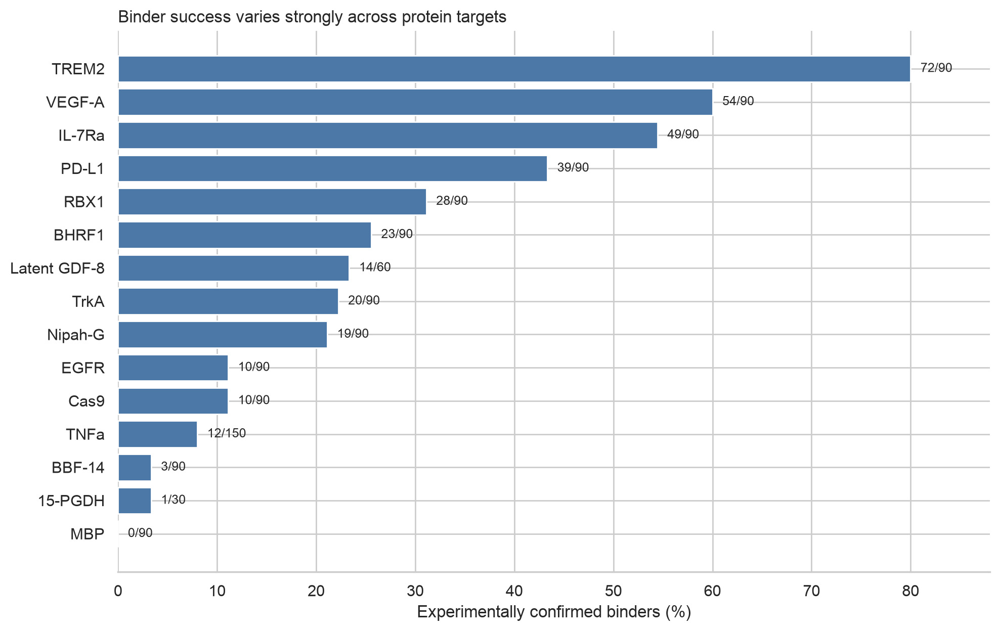
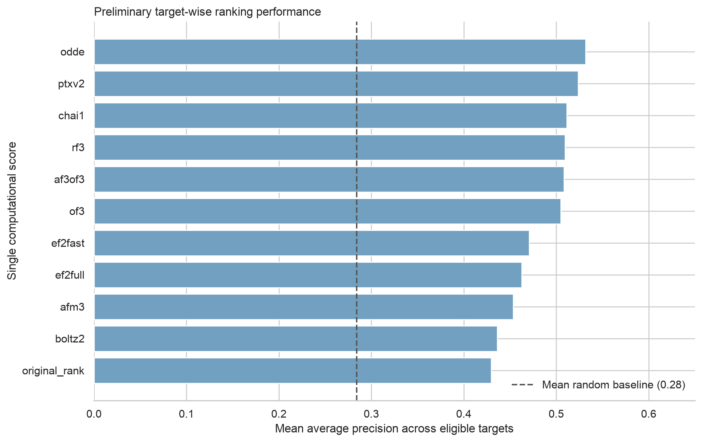

# BIOS 398 progress update

## Research question

Can computational structure-confidence scores rank experimentally successful
de novo protein binders for a previously unseen protein target?

## Work completed

- Set up a reproducible repository and Python environment.
- Downloaded the public tabular release and its documentation.
- Audited identifiers, labels, missingness, target composition, and feature
  provenance.
- Defined which variables are available before wet-lab testing and removed
  experimental leakage from the planned feature set.
- Calculated preliminary target-wise baselines for ten structure-prediction
  confidence scores and the original candidate rank.

## Dataset audit

- 1,440 unique designs across 16 protein targets
- 1,320 designs with interpretable experimental outcomes
- 354 experimentally confirmed binders and 966 measured nonbinders
- No duplicate UUIDs or duplicate amino-acid sequences
- 120 Mature GDF-8 designs have no usable outcome and will be excluded from
  supervised evaluation
- MBP has no positive designs and will be analyzed as a failure case rather than
  included in positive-dependent summary metrics

## Main result so far

Experimental success varies from 0% for MBP to 80% for TREM2. This variation
shows that the pooled 26.8% success rate does not describe performance on a new
target and that random row-level splitting would answer an easier question.

The primary evaluation will therefore hold out one complete protein target at a
time. Models will train on the remaining targets and rank designs for the unseen
target.

## Preliminary single-score baseline

The ten ipSAE structure-confidence scores achieve mean target-wise average
precision between approximately 0.44 and 0.53 across 14 targets containing both
positive and negative examples. The mean random-ranking reference is 0.28.

This is an untrained baseline, not the final generalization experiment. It shows
that individual structure scores contain useful signal while leaving substantial
room for target-specific failure and improved calibration.

## Leakage decision

The final binding label, experimental K_D values, vendor binding calls, and
vendor agreement are produced during wet-lab testing. They will be used to
construct or audit the outcome, not as model inputs.

Primary predictors will include:

- ipSAE scores from multiple complex-structure predictors
- structural agreement and disagreement across predictors
- scDockQ values where available
- binder length and sequence-derived properties
- design provenance in explicit sensitivity analyses

## Next experiments

1. Construct the pre-lab feature matrix and document every feature's provenance.
2. Implement leave-one-target-out folds with leakage checks.
3. Evaluate random ranking, original rank, and each individual structural score.
4. Train regularized logistic-regression and gradient-boosted-tree baselines.
5. Measure average precision, top-10 hit rate, enrichment, and calibration for
   every held-out target.
6. Analyze targets and designs where structural confidence is high but the
   experiment fails.

## Sixty-second oral update

I am studying whether computational confidence scores can predict which de novo
protein binders will succeed experimentally for a new protein target. I completed
the initial dataset audit. The release contains 1,440 unique designs across 16
targets, with reliable outcomes for 1,320 designs and 354 confirmed binders. The
largest result so far is that success varies from zero percent for MBP to eighty
percent for TREM2, so the overall success rate hides major target-to-target
variation. This changes the evaluation design: I will hold out an entire target
instead of randomly splitting individual designs. I also separated pre-lab
features from experimental variables to prevent label leakage. As a preliminary
baseline, individual structure-confidence scores perform above random ranking,
but none solves the problem on its own. The next step is to combine model
agreement, structural confidence, and sequence features in interpretable models
and test whether they generalize to each held-out target.

## Likely questions

### Why not use a random train-test split?

It would put designs from the same targets and design campaigns into both sets,
allowing the model to exploit target identity or related designs. The intended
use case is candidate selection for a target not observed during training.

### Why exclude K_D from the predictors?

K_D is measured in the wet lab and is frequently missing when a reliable binding
curve cannot be fitted. Its presence or value therefore reveals information
about the experimental outcome.

### Why is this more than reanalyzing a company result?

The study tests a claim that the release itself does not settle: whether
computational rankings transfer to an unseen target and whether uncertainty can
identify targets on which the ranking should not be trusted.

### Where do structural AI models enter the project?

The dataset contains complex predictions from ten structure models. The project
compares their confidence scores and disagreement against wet-lab outcomes. A
later extension can rerun selected predictors or use the validated ranking model
to prioritize newly generated binders.
